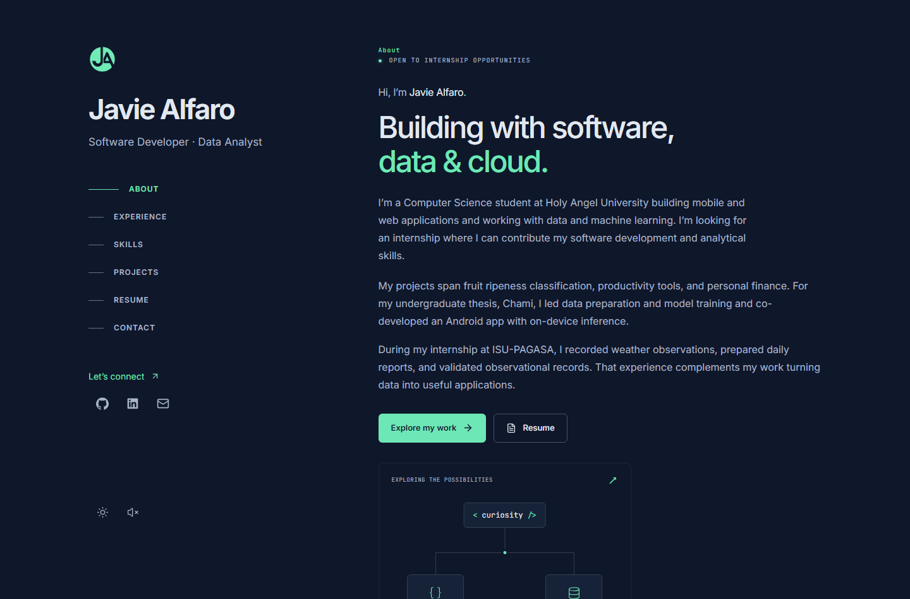
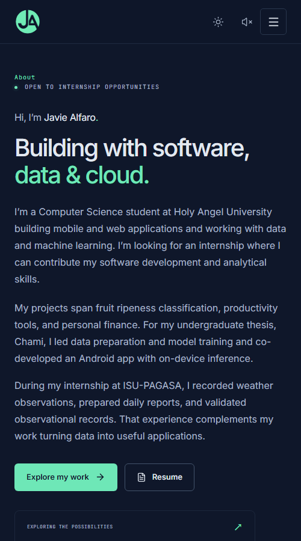

# Javie Alfaro | Developer Portfolio

A single-page portfolio for my software development and data work. It brings together selected projects, internship experience, education, certifications, and a downloadable resume.

[View the live portfolio](https://javiealfaro.vercel.app/) · [Browse selected projects](https://javiealfaro.vercel.app/#projects) · [View my resume](https://javiealfaro.vercel.app/#resume)

## Portfolio preview

**Desktop**



**Mobile**



## Selected projects

- **Chami** — An Android app for my undergraduate thesis that classifies fruit ripeness on the device. I led data preparation and model training and co-developed the app.
- **AlfaFocus** — A productivity dashboard with tasks, calendar planning, habit tracking, and focus sessions.
- **OnlyFunds** — An Android budgeting app that tracks income, expenses, and savings goals and forecasts spending from transaction history.

## How I built the portfolio

| Technology                  | Role in this site                                                                             |
| --------------------------- | --------------------------------------------------------------------------------------------- |
| React and TypeScript        | Reusable page sections and a typed model for projects, experience, skills, and certifications |
| Tailwind CSS                | Shared color and typography tokens, responsive layouts, and component styles                  |
| Motion for React and Lucide | Scroll reveals and interface icons                                                            |
| Vite and Vercel             | Local development, production builds, and hosting from GitHub                                 |

- **Content and layout.** The sections read from [one typed content file](src/data/portfolio.ts), so project and experience updates stay separate from presentation. The project filters come from the categories in that data.
- **Responsive navigation.** A desktop sidebar becomes a collapsible menu on smaller screens. Native anchor links let visitors share section URLs, and the active link follows their scroll position. The site includes keyboard navigation, a skip link, and reduced-motion support.
- **Browser interactions.** Light and dark themes and optional sound effects use local storage to remember preferences. The resume PDF loads in an embedded viewer only when a visitor requests a preview, with options to open or download it directly.
- **Static delivery.** Vite builds the site to `dist/`, with fonts bundled locally and the resume served as a static asset. The portfolio runs without a backend, database, or environment variables.

## Explore the code

- [`src/App.tsx`](src/App.tsx) assembles the page and configures shared motion behavior.
- [`src/components/`](src/components/) contains the page sections and interactive controls.
- [`src/data/portfolio.ts`](src/data/portfolio.ts) holds the content, with its shape defined in [`src/types/portfolio.ts`](src/types/portfolio.ts).
- [`src/index.css`](src/index.css) defines theme tokens, component styles, and breakpoints.

## Run locally

Use Node.js 22.12 or a newer supported LTS release. From the repository root:

```sh
npm ci
npm run dev
```

Open the local URL printed by Vite. Run `npm run build` for the production build and `npm run preview` to serve it locally. Use `npm run lint` and `npm run format:check` to check code and formatting.

Vercel deploys pushes to `main`. To update the resume preview and download, replace [`public/resume.pdf`](public/resume.pdf) using the same filename.
